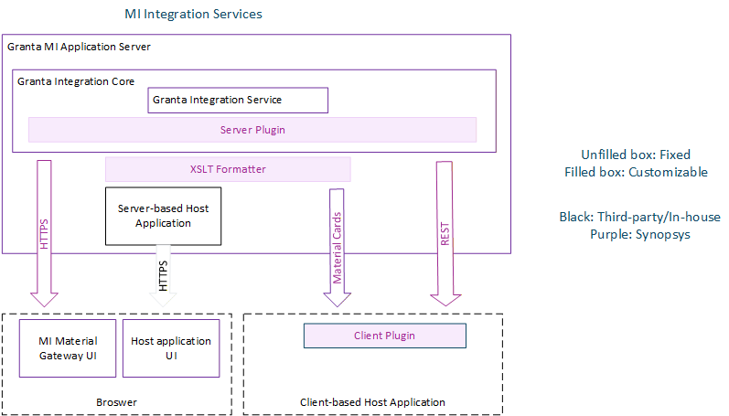

# User guide

The system architecture for an integration depends on whether the host application is server-based (for example, Windchill) or desktop client based (for example, NX).

| Component                        | Description                                                                                                                                                                                                                                                                                                                                |
| -------------------------------- | ------------------------------------------------------------------------------------------------------------------------------------------------------------------------------------------------------------------------------------------------------------------------------------------------------------------------------------------ |
| Granta MI Application Server     | The application server that hosts the core Granta MI software.                                                                                                                                                                                                                                                                             |
| Granta Integration Core          | A module of components of Granta MI that are used to communicate with integrations.                                                                                                                                                                                                                                                        |
| MI Integration Service | The part of Granta Integration Core that hosts the web API.                                                                                                                                                                                                                                                                                |
| MI Settings Service              | Stores `HostConfiguration` settings for your custom integration, that are used by both the Gateway Web Service and MI Integration Service.                                                                                                                                                                                             |
| Host Integration plugin          | Your custom integration code, that interacts with the MI Integration Service and writes data to your host application.                                                                                                                                                                                                                 |
| Server Plugin                    | A plugin that is written against the MI Integration Service, that interacts with a server-based host application.                                                                                                                                                                                                                |
| Client Plugin                    | A plugin that is written against the MI Integration Service, that interacts with a desktop client based host application.                                                                                                                                                                                                        |
| Host Application                 | The system that you are integrating with - for example, a CAD, CAE, PLM, or SDPM system.                                                                                                                                                                                                                                                   |
| Launch Point                     | For server-based host integrations: A customization or plugin to the host client user interface (for example, a web interface) that opens a browser and requests an instance of MI Materials Gateway for the specified host |

Creating and deploying a custom MI Gateway integration for a host application involves the following tasks:

1. Writing the Host Integration plugin.
    * For server-based hosts, this is a plugin to the MI Integration Service and as such must implement well-defined C# interfaces. The MI Integration Service uses the plugin to 'push' data into the host application server when a material is selected.
    * For desktop client based hosts, this is a plugin to the host application. The plugin 'pulls' data from the MI Integration Service after it has been selected, and typically writes it to a library or project within the host application. It may be written in any language supported by the deskop host, but *must* support making HTTP requests to communicate with the MI Integration Service.
2. Deploying the plugin on your system, and any configuration of the host application that this requires.
    * For server-based hosts, the plugin must be installed in a folder on the Granta MI application server, and registered with Granta MI as part of the `Host Configuration`.
    * For desktop client based hosts, the plugin must be installed on the host client machine, and registered in the usual way for customizations to that host application.
3. Adding a `Host Configuration` in Granta MI Settings. This defines the unique `HostID` that identifies your integration, and specifies any customizable options (for example, default exporters to use for materials data).
4. For server-based hosts: Creating the Launch Point in the host client, that opens a browser and requests an instance of MI Material Gateway.
    * The request URL must include the `HostID` for your integration, and can optionally specify a solver package.

## Getting started

Server plugins and client plugins are both responsible for ensuring materials data can flow between the MI Integration Service and the host application, but the communication mechanism differs in each case.

### Server plugins

Server plugins receive selected materials data as an in-process `AddMaterials` method call, specified in the `IPlugin` interface. This interface is described in the [Server Plugin](xref:Ansys.GrantaMI.IntegrationCore.ServerPlugin.V1) page. The server plugin should define an `AddMaterials` implementation that pushes the data into the server host. A server plugin example is provided which writes materials data to a file on the Granta MI application server. The example is documented [here](example-server-material-logger.md).

Server plugins do not need to connect to Granta MI, since they run in-process within Granta MI itself. They typically need to authenticate with the host application.

### Client plugins

Client plugins are responsible for fetching materials data from the MI Integration Service REST API as an HTTP GET or SSE reqeust. This interface is defined in the [MI Integration Service](xref:MI%20Integration%20Service/1.1.0) page. Client plugins must then write materials data into the host using the host application's API. Two client plguins are provided:

* A C# example using SSE is available [here](example-desktop-csharp.md).
* A Python example using HTTP GET requests is available [here](example-desktop-python.md).

In order to connect to the Granta MI system, the client plugin must authenticate using the method chosen by your Granta MI system administrator. This will be one of the following:

* Windows authentication
* Basic authentication
* OIDC authentication

The examples listed in this section include example implementations of each authentication type.

## Identifying host integrations

Each custom MI Materials Gateway integration on your Granta MI system must have a unique identifier. This is specified in the Host Configuration as the `HostID`, and is case-insensitive.

If required, you can deploy and configure more than one integration for the same host application, provided they have different `HostID` values. For example:

* If you are working with more than one host application server, each server requires a separate integration that authenticates and writes data to that server.
* If you want to customize functionality for different user groups, you can deploy a separate integration for each group.

Each integration must have a separate Host Configuration in MI Settings, and a separate launch point in the host application that includes the required `HostID` in its MI Materials Gateway URL.

