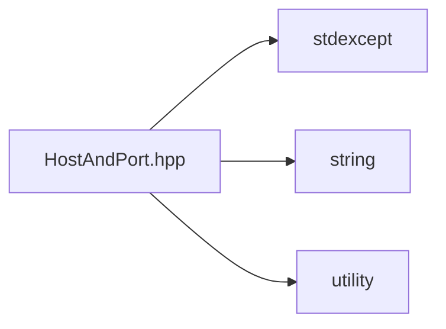

# File HostAndPort.hpp

![][C++]

**Location**: `HostAndPort.hpp`


## Classes

* [sysc::HostAndPort](structsysc_1_1HostAndPort.md#structsysc_1_1HostAndPort)

## Namespaces

* [sysc](namespacesysc.md#namespacesysc)

## Includes

* <stdexcept>
* <string>
* <utility>





## Source


```cpp
/*
 * © 2025-2026 ANSYS, Inc. Unauthorized use, distribution, or duplication is prohibited.
 */

#pragma once

#include <stdexcept>
#include <string>
#include <utility>

namespace sysc {


using Port = unsigned short; 
using Host = std::string;    

struct HostAndPort {
  HostAndPort() = default;

  HostAndPort(Host host, Port port) :
      host(std::move(host)), port(port) {}

  HostAndPort(Port port) :
      port(port) {}

  Host host;
  Port port{0};
};


}  // namespace sysc
```


[public]: https://img.shields.io/badge/-public-brightgreen (public)
[const]: https://img.shields.io/badge/-const-lightblue (const)
[C++]: https://img.shields.io/badge/language-C%2B%2B-blue (C++)
[private]: https://img.shields.io/badge/-private-red (private)