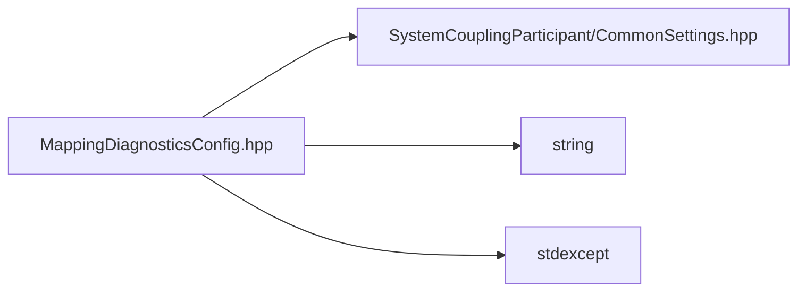

# File MappingDiagnosticsConfig.hpp

![][C++]

**Location**: `MappingDiagnosticsConfig.hpp`


## Classes

* [sysc::MappingDiagnosticsConfig](structsysc_1_1MappingDiagnosticsConfig.md#structsysc_1_1MappingDiagnosticsConfig)

## Namespaces

* [sysc](namespacesysc.md#namespacesysc)

## Includes

* SystemCouplingParticipant/CommonSettings.hpp
* <string>
* <stdexcept>





## Source


```cpp
/*
 * © 2026 ANSYS, Inc. Unauthorized use, distribution, or duplication is prohibited.
 */
#pragma once

#include "SystemCouplingParticipant/CommonSettings.hpp"

#include <string>
#include <stdexcept>

namespace sysc {
struct MappingDiagnosticsConfig {
  std::string getMappedDiagnosticVariableName(
    const std::string& interfaceName,
    const std::string& targetVariableName,
    Location location) const
  {
    std::string prefix;
    if (location == Location::Node) {
      prefix = "MappedNode_";
    }
    else if (location == Location::Element) {
      prefix = "MappedElement_";
    }
    else {
      throw std::invalid_argument("Invalid location specified for diagnostics variable name.");
    }
    return prefix + interfaceName + "_" + targetVariableName;
  }

  bool enableDiagnostics{false};         
  bool generateNodesDiagnostics{false};  
  bool generateElemsDiagnostics{false};  
};
}  // namespace sysc
```


[public]: https://img.shields.io/badge/-public-brightgreen (public)
[const]: https://img.shields.io/badge/-const-lightblue (const)
[C++]: https://img.shields.io/badge/language-C%2B%2B-blue (C++)
[private]: https://img.shields.io/badge/-private-red (private)