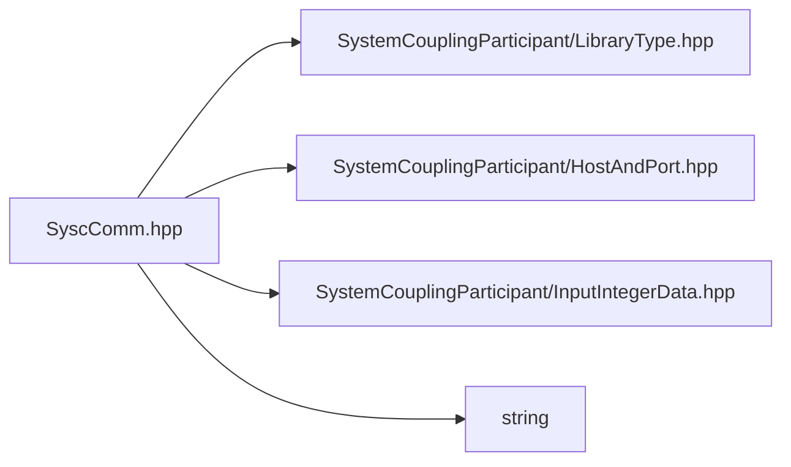

# File SyscComm.hpp

![][C++]

**Location**: `SyscComm.hpp`


## Namespaces

* [sysc](namespacesysc.md#namespacesysc)

## Includes

* SystemCouplingParticipant/LibraryType.hpp
* SystemCouplingParticipant/HostAndPort.hpp
* SystemCouplingParticipant/InputIntegerData.hpp
* <string>





## Source


```cpp
/*
 * © 2025-2026 ANSYS, Inc. Unauthorized use, distribution, or duplication is prohibited.
 */

#pragma once

#include "SystemCouplingParticipant/LibraryType.hpp"

#include "SystemCouplingParticipant/HostAndPort.hpp"
#include "SystemCouplingParticipant/InputIntegerData.hpp"

#include <string>

namespace sysc {

HostAndPort SYSTEM_COUPLING_PARTICIPANT_DLL createRootServer(Host host, Port port);

bool SYSTEM_COUPLING_PARTICIPANT_DLL isRootServerCreated();

int SYSTEM_COUPLING_PARTICIPANT_DLL getMyRank();

int SYSTEM_COUPLING_PARTICIPANT_DLL getNumRanks();

double SYSTEM_COUPLING_PARTICIPANT_DLL reduceMax(double value);

std::uint16_t SYSTEM_COUPLING_PARTICIPANT_DLL reduceMax(std::uint16_t value);

std::uint64_t SYSTEM_COUPLING_PARTICIPANT_DLL reduceSum(std::uint64_t value);

bool SYSTEM_COUPLING_PARTICIPANT_DLL reduceAnd(bool value);

void SYSTEM_COUPLING_PARTICIPANT_DLL broadcast(IntegerData data, int rootRank);

#ifdef SYSTEM_COUPLING_PARTICIPANT_DATASHIPPER

void SYSTEM_COUPLING_PARTICIPANT_DLL datashipperInitializeRoot(
  std::size_t numApps,
  std::size_t mpiCommunicator);

void SYSTEM_COUPLING_PARTICIPANT_DLL datashipperInitializeNonRoot(
  const HostAndPort& rootServer,
  std::size_t mpiCommunicator);

void SYSTEM_COUPLING_PARTICIPANT_DLL datashipperFinalize();

#endif

}  // namespace sysc
```


[public]: https://img.shields.io/badge/-public-brightgreen (public)
[const]: https://img.shields.io/badge/-const-lightblue (const)
[C++]: https://img.shields.io/badge/language-C%2B%2B-blue (C++)
[private]: https://img.shields.io/badge/-private-red (private)