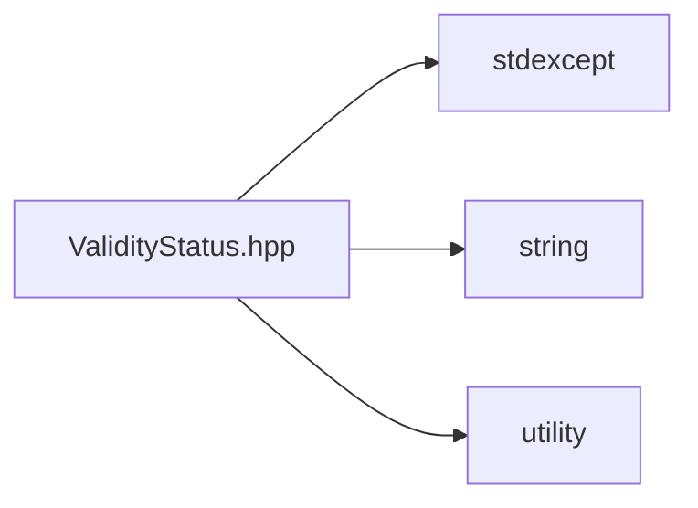

# File ValidityStatus.hpp

![][C++]

**Location**: `ValidityStatus.hpp`


## Classes

* [sysc::ValidityStatus](structsysc_1_1ValidityStatus.md#structsysc_1_1ValidityStatus)
* [sysc::MeshValidityStatus](structsysc_1_1MeshValidityStatus.md#structsysc_1_1MeshValidityStatus)

## Namespaces

* [sysc](namespacesysc.md#namespacesysc)

## Includes

* <stdexcept>
* <string>
* <utility>





## Source


```cpp
/*
 * © 2025-2026 ANSYS, Inc. Unauthorized use, distribution, or duplication is prohibited.
 */

#pragma once

#include <stdexcept>
#include <string>
#include <utility>

namespace sysc {


struct ValidityStatus {
  bool isValid;        
  std::string message; 

  /* \brief Provide a default constructor for ValidityStatus */
  ValidityStatus() :
      isValid(true) {};

  ValidityStatus(bool isValid, std::string message) :
      isValid(isValid),
      message(std::move(message)) {};
};

struct MeshValidityStatus {
  bool isInvalid;      
  std::string message; 

  /* \brief Provide a default constructor for MeshValidityStatus */
  MeshValidityStatus() :
      isInvalid(false) {};

  MeshValidityStatus(bool isInvalid, std::string message) :
      isInvalid(isInvalid),
      message(std::move(message)) {};
};

}  // namespace sysc
```


[public]: https://img.shields.io/badge/-public-brightgreen (public)
[const]: https://img.shields.io/badge/-const-lightblue (const)
[C++]: https://img.shields.io/badge/language-C%2B%2B-blue (C++)
[private]: https://img.shields.io/badge/-private-red (private)