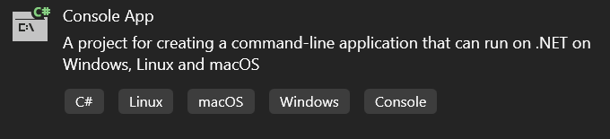
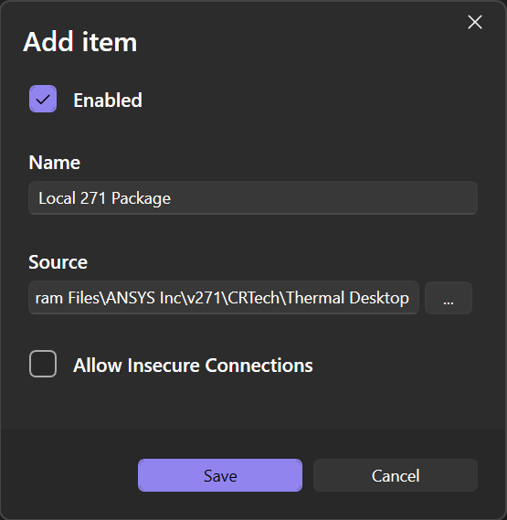
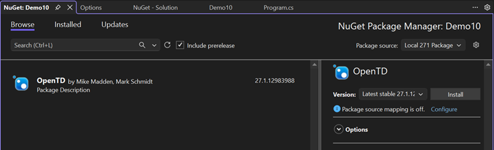

# Hello World (Start TD and create a node)

Let’s create a simple OpenTD client program that will interact with Thermal Desktop. Currently this sort of program requires AutoCAD 2018 through 2024. It will not work with AutoCAD 2025 and above.

Start by creating a `C#` console application in Visual Studio. Look for the template called “Console App". Unlike previous versions of OpenTD, you must not select Framework. This is .NET Core project. It should look something like this:



Next, select the name and location for your project. On the next tab, be sure to select ".NET 10.0 (Long Term Support)" as the Framework. 

Once the empty project and solution have been created by Visual Studio, you must set the properties of project to use a Target OS of Windows. You can do this by right-clicking on the name of the porject in the Solution Explorer and selecting Properties. Use the pull-down to set Target OS to Windows. 

The OpenTD dlls are contained in a NuGet package that has been installed to the Thermal Desktop installation package. You will need to tell Visual Studio where to look for the NuGet package. Do this by selecting `Tools > NuGet Package Manager > Package Manager Settings`. On the left column, select Sources. You must Add a new source as shown here. The exact name is not important, but the Source should be the Thermal Desktop installation directory.



Finally, add the NuGet package to your project. Right-click on your Project file in the Solution Explorer again and select `Manage NuGet Packages`. On the top left of this tab, click Browse. On the top right, set the NuGet source to the name you selected for source, which in this example is `Local 271 Package`. Select the OpenTD package and click Install.  



Check the Output tab to ensure that it was installed correctly. A common problem is not setting the Target OS to Windows first, which is required for this package to install. 

Once the NuGet source has been set, you should not need to set it for your account on this computer again. The source information is set in a `%AppData%\NuGet\NuGet.Config`. However, you will need to install the package for each OpenTD project you create. The purpose of the NuGet package is to contain all the necessary dlls, which include OpenTD, OpenTD.Results, and OpenTD.CoSolver along with all their dependencies. When you build a program using the NuGet package, all the dlls will be included with it.

After you have ensured the OpenTD NuGet package has been installed, add the following code, then compile and run the program:

```csharp
using OpenTD;
namespace OpenTDGettingStarted
{
    class HelloWorld
    {
        public static void Main(string[] args)
        {
            var td = new ThermalDesktop();
            td.Connect();
            var n = td.CreateNode();
            n.Comment = "Hello World!";
            n.Update();
        }
    }
}
```

When you run the program, an instance of TD should open and a node should be created at (0, 0, 0). When you edit the node, the comment should be “Hello World!”. If any of these things are not true, check the [Troubleshooting](./../troubleshooting.md) section at the end of this guide.

Assuming it worked, let’s examine how. First, we created a `ThermalDesktop` object called `td`. This object represents one instance of TD. It has hundreds of methods for interacting with TD models. A single OpenTD client program can create an arbitrary number of ThermalDesktop instances, allowing you to manipulate several models and communicate between them.

Next, we called the `ThermalDesktop.Connect()` method. By default, this will start a new instance of TD using the latest version of AutoCAD installed. You can control how it works using the `ThermalDesktop.ConnectConfig` property ([Control how OpenTD connects to Thermal Desktop section](./../extras.md#control-how-opentd-connects-to-thermal-desktop)).

`Connect()`, like most ThermalDesktop commands, is called synchronously, so it will only return control to your program once it finishes. If there is a problem, it will throw an exception. All OpenTD methods throw exceptions if there is a problem; you do not need to check return values for success.

Once `Connect()` returned, we called `ThermalDesktop.CreateNode()` to create a node in TD with default settings. We put the return value in a variable called n. This variable is of type `Node` and represents the TD node in our client program.

Next, we updated the `Comment` member of n. This only updated the comment for the client-program Node. To send that update to TD, we called the `Node.Update()` method. This is an important concept to understand; when you work with objects in your client program that represent objects in TD, they do not automatically propagate their changes to TD. To do that, you need to call the `Update()` method. (Some objects also have`UpdateFromTD()` methods to get the latest changes from TD.)
