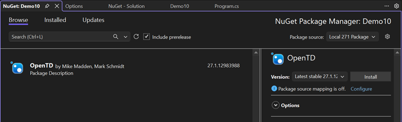

# OpenTD NuGet Packages
## .NET Versions
The .NET version of OpenTD is necessarly paired with the version as AutoCAD. There are two relevant families of .NET, which are Framework and Core. Framework is slightly older, but still supported with version .NET 4.8. Core is newer and updates frequently, offering support for three years on each version. Updating from one version of Core to another (such as .NET 8 to .NET 10) is very easy.

AutoCAD 2024 used .NET 4.8 (Framework). Starting with AutoCAD 2025, AutoCAD changed to .NET 8 (Core). AutoCAD 2027 used .NET 10 (Core). 

### Updating from .NET Framework
If you have .NET Framework OpenTD programs from a previous version, you will need to update them to work with .NET Core. In the past, OpenTD could work with multiple versions of Thermal Desktop, but there is no mechanism to connect OpenTD in .NET Framework to AutoCAD in .NET Core.

There may be some minor changes in your code when converting to Framework to Core such as minor syntax updates. The major changes will be how to reference OpenTD dlls and project settings. If you have access to AI tools in Visual Studio, they can help convert projects to .NET 10. 

## GAC vs NuGet
Using .NET Framework, all dlls were copied into the Global Assembly Cache (GAC). The OpenTD dlls were installed to the GAC along with any of their dependences, and when OpenTD dlls were added to a project, their dependencies were also located. 

Using .NET Core, dlls are no longer installed into the GAC. It possible to add the dlls to a project directly, but the dlls may not be able to locate their dependencies unless they are copied into the run directory. 

Instead, OpenTD has been put into a NuGet package and installed to the Thermal Desktop installation directory. A NuGet package is a type of zip directory with all the necessary filed organized in a specific way. The NuGet package contains all the OpenTD dlls and dependencies. When using a NuGet package, all necessary dlls will be copied into the run directory automatically. Note that when using Python, you will need to unzip the NuGet package and copy the relevant files. 

## Installing OpenTD NuGet Package
These instructions apply to C# projects in Visual Studio. Please see the appendix for working with other languages.

### Nuget.Config
NuGet can look for packages to install in many locations. Most commonly these packages are online, but in this case OpenTD has been installed locally to the Thermal Desktop installation directory. By default, that is `C:\Program Files\ANSYS Inc\v271\CRTech\Thermal Desktop`. The NuGet package is called `OpenTD.27.1.*.nupkg`.

NuGet must be configured to look for that package. You may copy the NuGet package to another location, but these instructions will assume it is in the original location. A configuration file called `NuGet.Config` will specify where NuGet will look for packages. You can find this file by typing `%AppData%` into a Windows Explorer window and then going into the NuGet directory.

It is possible to have several versions of NuGet.Config, and they will typically add the repositories. For example, you can make your own NuGet.Config file in your solution directory. One way to add the repository is to edit Nuget.Config in a text editor and add the following line directly to the packageSources section.

`<add key="Local 271 Package" value="C:\Program Files\ANSYS Inc\v271\CRTech\Thermal Desktop"/>`

The name should be descriptive, and the value must be the directory that contains the OpenTD NuGet package.

To add the repository to NuGet.Config using Visual Studio instead, go to `Tools > NuGet Package Manager > Sources`. Click the Add button. As with entering the repository manually, enter any descriptive name, and set the source to the local directory with OpenTD.27.1.*.nupkg.

If you click on the button in `These settings are stored in [NuGet.Config] files`, you can see exactly which NuGet.Config file is being updated with these settings. Putting this source into the NuGet.Config that is in your user directory means you will not need to add it for other projects. 

### Adding OpenTD to a Project

The OpenTD NuGet package requires that the Target OS is set to Windows, which is not a default setting. Right-click on the project file in the Solution Explorer and select Properties. Under `Application > General`, ensure the Target Framework is set to .NET 10 and the Target OS is Windows. 

To install the OpenTD NuGet package, right-click on the project file and select `Manage NuGet Packages`. On the top left, select Browse. On the top right, set the Package Source to the name of your local source or All. Look for OpenTD, and select Install. 

Review the Output tab to verify the package has been installed. 

You can now use OpenTD, OpenTD.Results, and OpenTD.CoSolver and all their dependencies.